# TVFollow

**Turns a TV with Roku built in on and off along with your PC's monitors.** Handy when
the TV is one of your screens.

> **How it works:** TVFollow is a remote control. It presses the TV's power and input
> buttons by sending the same remote signals the Roku phone app sends, straight to the
> TV over your home network. It doesn't change anything on your PC's displays, and none
> of this goes through the internet.

- Your monitors go to sleep, so the TV turns off too.
- You come back and move the mouse, so the TV turns on and switches to your PC.
- Sleep and shutdown turn it off as well.
- It only turns the TV off while the TV is showing your PC, so it never interrupts
  someone watching something else on it.
- More than one TV as a screen? Each one follows along, with its own input.

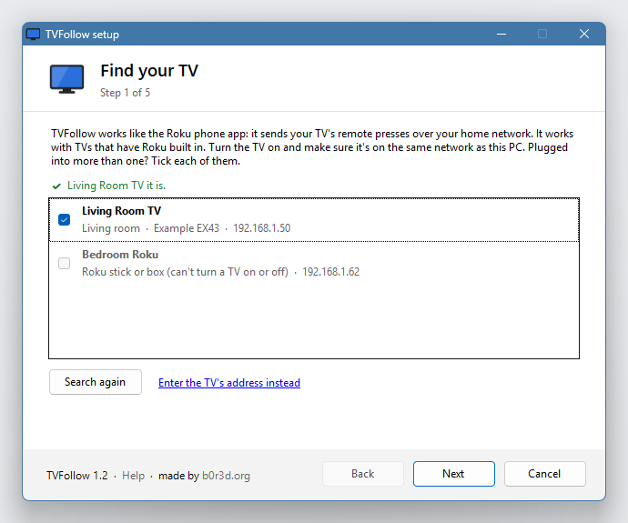

## What you need

- Windows 10 or Windows 11.
- A TV with Roku built in, the kind where the Roku menu *is* the TV's menu. Plenty of
  brands make them (TCL, Hisense, onn, Sharp and more). A Roku stick or
  box plugged into an ordinary TV won't work: it can't turn that TV on or off.
- The TV and the PC on the same home network. The TV can use Wi-Fi or a cable.

## Install

1. Download **TVFollow.exe** from the [latest release](https://github.com/still-b0r3d/TVFollow/releases/latest).
2. Open it.
   - Your browser may say the file isn't commonly downloaded. Choose **Keep**.
   - Windows may say **"Windows protected your PC"**. Click **More info**, then
     **Run anyway**. This happens because TVFollow isn't code-signed (signing costs
     money every year). If you'd rather not trust a download, [build it yourself](#build-it-yourself).
3. The setup window walks you through the rest, below. It takes about a minute.

TVFollow installs just for your Windows account and never asks for admin rights.

### Or run it portable

Rather not install anything? On setup's last page, choose **Portable: run from this
folder and change nothing else on this PC**. Put TVFollow.exe in a folder of your own
first (not straight out of a zip). TVFollow then keeps its settings and log in a
`TVFollow data` folder next to the exe, and touches nothing else: no Start menu, no
Apps list, no registry. It won't start by itself when you sign in, so open it when you
want it. To remove it, right-click the tray icon → **Quit TVFollow** and delete the
folder. To update it, replace TVFollow.exe in that folder.

## Setup, step by step

**1. Find your TV.** TVFollow looks for TVs on your network and ticks yours if there's
only one. Is the PC plugged into more than one TV? Tick each of them; steps 2 to 4 then
go through them one at a time. If a TV isn't listed, click **Enter the TV's address
instead**. The TV shows its address under **Settings → Network → About**.

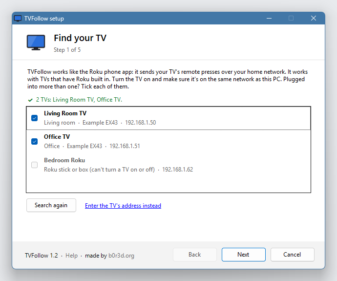

**2. Let this PC control the TV.** Newer Roku TVs come set to *Limited*, which lets
phones and PCs open apps but blocks the power button. If yours is on Limited, the
window shows what to press:

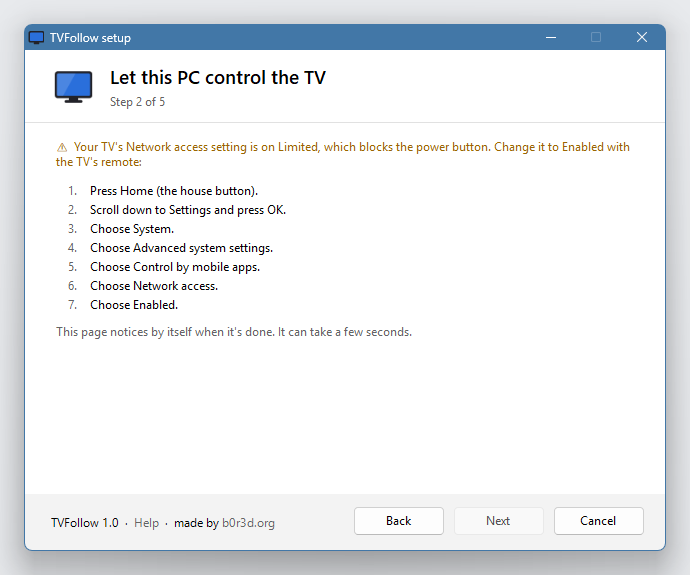

On the TV, with its remote: **Home → Settings → System → Advanced system settings →
Control by mobile apps → Network access → Enabled**. The window ticks itself off once the
TV says Enabled. "Enabled" only lets devices on your home network control the TV, not
the internet.

**3. Pick the input.** Choose the HDMI input your PC is plugged into. TVFollow picks the
one the TV is showing right now, and uses the names you've given your inputs on the TV.
**Show it on the TV** switches the TV to that input so you can check.

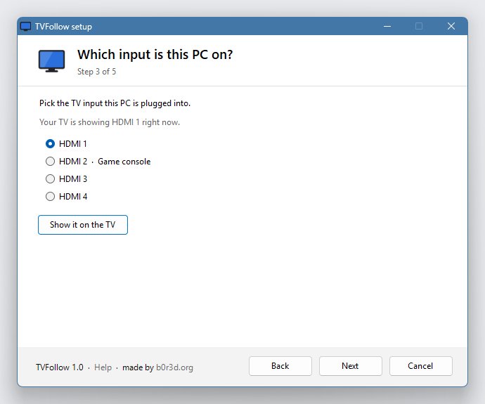

**4. Test it.** TVFollow turns the TV off, checks it can still reach it, and turns it
back on showing your PC. It takes about 15 seconds.

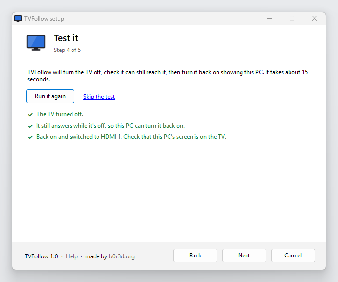

If the TV can't be reached while it's off, turn on **Fast TV start** on the TV
(**Settings → System → Power → Fast TV start**) and test again. Without it, some TVs
switch their network off along with the screen.

**5. All set.** Choose what TVFollow should do (including whether it tells you about new
versions) and whether to install it or run it portable, then click **Finish**.

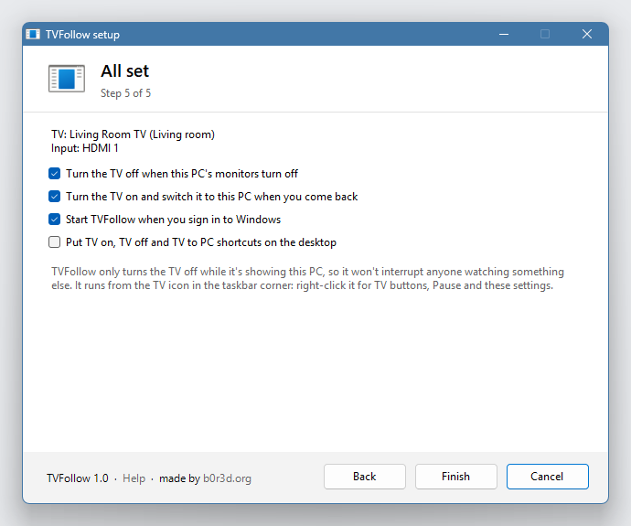

## Using it

TVFollow runs from a small TV icon in the taskbar corner. You might need to click the
**^** arrow to see it. Right-click it:

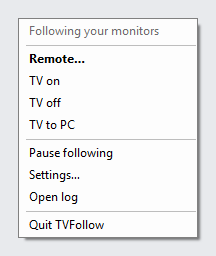

- **Remote…**: a TV remote on your screen (below).
- **TV on / TV off / TV to PC**: buttons for the TV, any time.
- **Pause following**: leave the TV alone until you resume (even across restarts), for
  example while someone watches TV and your PC goes to sleep. The icon turns grey while
  paused.
- **Settings…**: the Settings window (below). Double-clicking the icon does the same.
- **Developer tools…**: only there once you've switched on the
  [developer tools](#developer-tools) in Settings. It opens Settings on their pages.
- **Open log**: what TVFollow did and when, handy if something seems off.
- **Quit TVFollow**: stops it. It starts again when you sign in (if it starts with
  Windows) or when you open TVFollow from the Start menu.

With two or more TVs the buttons read **All TVs on**, **All TVs off** and **All TVs to
PC**, and each TV gets a menu of its own (named as the TV calls itself) with its own TV
on, TV off, TV to PC and remote.

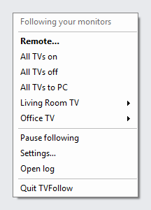

### The remote

**Remote…** opens a remote above the taskbar corner, with every button that makes
sense from a PC: power, **TV to PC**, Back, Home, the arrows and OK, Options (✱),
instant replay, Search, rewind, play/pause and fast-forward, volume and mute, and your
TV's inputs by the names you gave them.

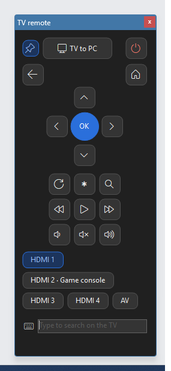

- While the remote has focus, the keyboard works too: the **arrow keys**, **Enter**
  (OK), **Backspace** (Back), **Space** (play/pause), **Home**, and **+** / **-** for
  the volume. Hold a volume button to keep going.
- The box at the bottom types into the TV: whatever you type goes into the TV's search
  boxes, a lot faster than picking letters with the arrows.
- The pin keeps the remote above other windows; **Esc** closes it.
- Prefer a different shape? Settings has three: **Classic** (above), **Compact** and
  **Wide strip**.
- With two or more TVs, a drop-down at the top of the remote picks the TV it works.

| Compact | Wide strip |
|---|---|
| 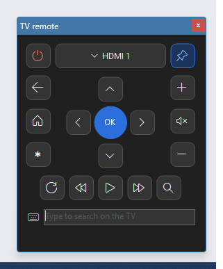 | 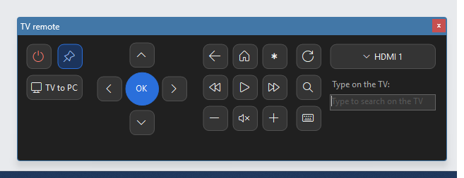 |

Voice search needs the microphone in the real remote, so it isn't here. The TV's picture
settings work the way they do with the real remote: **Options (✱)** or **Home →
Settings**, then the arrows.

### Settings

Right-click the icon → **Settings…**, double-click the icon, or open TVFollow from the
Start menu while it's running. Pick a page from the list down the left (the arrow keys work
too). Changes apply straight away.

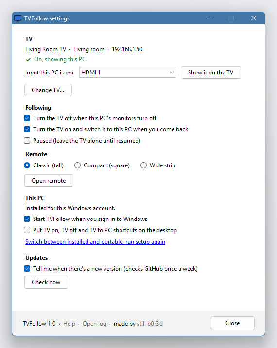

- **TV:** which TV and whether it's answering, and the input your PC is on (for each
  TV, numbered, when there are several). **Add or change TVs…** runs setup again: tick a
  new TV to add it, untick one to stop using it. TVs already set up keep their settings.
- **Following:** the two follow options, and Pause.
- **Remote:** the layout, and a button to open it.
- **This PC:** start with Windows and the desktop shortcuts. Switching between installed
  and portable runs setup again.
- **Updates:** the weekly check, and **Check now**.
- **Developer tools:** their switch, for putting your own Roku apps on the TV. Switched
  on, this page shows the TV's developer mode and its password, and two more pages come
  up under it: **App on the TV** and **App options** (see [Developer tools](#developer-tools)).

If you ticked the desktop shortcuts option, **TV on**, **TV off** and **TV to PC** are on
your desktop too.

When a new version is out, a notification says so and the menu gets a **Get TVFollow …**
item that opens its download page. To update, download the new TVFollow.exe and open it:
setup remembers your TVs and keeps their settings, so it's **Next**, then **Finish**, and
finishing replaces the old version.

### How it decides

- **Monitors off** (Windows' screen timeout, sleep or shutdown): the TV turns off, but
  only if it's showing your PC.
- **Monitors back on, and you've touched the mouse or keyboard:** the TV turns on and
  switches to your PC. If someone is watching something else on it, it's left alone.
- **Monitors back on with nobody there** (a notification, a screen being plugged in):
  TVFollow waits for the mouse or keyboard before turning the TV on.
- **The router gave the TV a new address:** TVFollow finds it again by itself. After a
  router swap, press **TV to PC** in the tray once (details in [How it works](docs/HOW-IT-WORKS.md)).
- **Several TVs:** each one goes by these rules on its own, all at the same time, so one
  TV that's slow to wake doesn't hold up the others.

More detail in [How it works](docs/HOW-IT-WORKS.md).

## Change settings or uninstall

- **Change settings:** right-click the tray icon → **Settings…**, or open **TVFollow**
  from the Start menu while it's running (if it isn't running, that starts it).
- **Add, remove or change TVs, or switch between installed and portable:** **Settings… →
  Add or change TVs…** or the "run setup again" link there.
- **Uninstall:** **Settings → Apps → Installed apps → TVFollow → Uninstall** (on
  Windows 10: **Settings → Apps → Apps & features**). That removes the program, its
  shortcuts, its settings and its log. Nothing on the TV changes.

## Developer tools

For making your own Roku apps, or trying one someone made for you: TVFollow can put an app
on the TV straight from your PC, using the TV's **developer mode**. Most people never need
this, so it's hidden until you switch it on: **Settings… → Developer tools → Turn on the
developer tools**. Its pages are then in Settings (**Developer tools**, **App on the TV**
and **App options**), and **Developer tools…** in the tray menu opens them.

**Turn developer mode on** (once for each TV). This takes the TV's own remote: the TV
ignores the code when TVFollow sends it, so TVFollow's remote can't do it.

1. Press **Home** 3 times, **Up** 2 times, then **Right, Left, Right, Left, Right**.
2. On the **Developer settings** screen, choose **Enable installer and restart**, agree
   to Roku's license, and pick a password.
3. The TV restarts. Type the same password into the developer tools.

If the TV asks, first sign up for Roku's free developer program at
[developer.roku.com](https://developer.roku.com), with the Roku account the TV uses. The
developer tools say when developer mode is on. To turn it off, press the same code and
choose **Disable installer and restart**.

**Push an app** (on **App on the TV**):

- **Push a .zip…**: an app as a zip, with its `manifest` file at the top.
- **Push a folder…**: your app's own folder, the one with the `manifest` file. TVFollow
  zips it for you, leaving out things like `.git`, `Thumbs.db` and editors' temporary
  files. If the app is one folder down (you picked the folder around it, or the zip has
  the app in a folder), TVFollow finds it there.
- **Push the example app**: [b0r3d TV](https://github.com/still-b0r3d/b0r3d-TV), built
  into TVFollow, to check it all works: a channel guide like an old cable box's, where
  your TV's apps are channels next to b0r3d's own: a VCR, a camera on Rukus's room,
  three games, a radio station and late-night commercials. With **Let the app switch the
  TV's inputs** ticked (below), the TV's inputs show up in its guide as channels a few
  seconds after it opens, and opening one switches the TV: the asking described below,
  at work, in its `source/tvfollow.brs`. Its source is in
  [examples/tvfollow-example](examples/tvfollow-example), under its own license (see
  [License](#license)). Once it's on the TV, it goes on the internet by itself (see
  [Privacy](#privacy)).

The TV opens an app as soon as it has it. It holds one pushed app at a time, so pushing
another replaces it.

- **Open on the TV** and **Remove**: start the app, or take it off the TV.
- **Screenshot…**: saves a picture of the app's screen. Roku only takes pictures of the
  pushed app.
- **App log…**: what the app prints, and the error and the line it stopped at if it
  crashes. It shows what happens while it's open, so open it first, then push or open
  the app. Look here when an app won't start. Whatever TVFollow reads of the app log
  (for this window, or for the inputs option below) also goes into a file,
  `%APPDATA%\TVFollow\dev\<the TV's serial number> app log.txt`, so a crash can be read
  afterwards. It keeps the newest 2 MB or so.

**Options** (on **App options**):

- **Open the app whenever the TV goes to Roku's home screen** (off to start with): makes
  the app the TV's home screen. Turning the TV on, or backing out of another app (Back out
  of YouTube, say), lands in your app instead of Roku's home screen, a few seconds later.
  On the way from an app to one of its inputs the TV passes Roku's home screen too. That
  doesn't count when TVFollow switched the input (for your app, or from its remote or
  Settings), or when it's gone within 4 seconds (it took about 2.5 on a Roku TV with Roku
  OS 16), so the TV stays on the input. Press **Home** twice in a row to stay on Roku's
  home screen: going home again right after TVFollow opened the app means you wanted it,
  and the TV stays there until it shows something else or turns off. It works while this
  PC is on and TVFollow runs, never while following is paused, and only on a TV that's on.
- **Put the app back when it disappears from the TV** (on to start with): the TV can lose
  its pushed app, after a Roku update, say. TVFollow keeps a copy of the app you pushed
  last and puts it back the next time it turns the TV off with your monitors, while
  nobody's looking at the screen. If developer mode itself was turned off, or the app
  couldn't go back, a notification says so.
- **Push the app's folder again whenever a file in it is saved**: for making apps. Save
  a file, and a moment later the TV runs your new version.
- **Let the app switch the TV's inputs** (off to start with): a Roku TV won't let an app
  switch its inputs (to a game console on HDMI 2, say), so the pushed app can ask TVFollow,
  which switches the TV for it while this PC is on. How an app asks is just below.

**Switching inputs from your app** (for app makers), with that option ticked. While your
app is on screen, TVFollow reads its console, the one **App log…** shows:

1. A few seconds after your app opens, TVFollow says hello with an input event, which
   your app reads with `roInput`: `tvfollow=hello`, `protocol=1`, `token` (a code for
   your asks), `pc` (the input this PC is on, like `tvinput.hdmi1`), `inputs` (how many),
   then `input1`, `name1`, `input2`, `name2` and so on: each input's id and the name the
   TV gives it. No hello means TVFollow isn't running or the option is off, so keep your
   input buttons hidden until one comes.
2. To switch, print `TVFollow ask`, the token from the latest hello and the input's id:

   ```brightscript
   print "TVFollow ask " + token + " tvinput.hdmi2"
   ```

   TVFollow switches the TV within a second or so, only to an input from its list. An
   ask with an older token is ignored, because the TV repeats its recent console lines to
   anything that connects.
3. Print `TVFollow hello` when your app wants a hello again (when it has just started,
   say).

The TV lets one program read an app's console at a time. While your app is on screen,
this option and another tool reading the console (a debugger, say) get in each other's
way, so untick the option while you use the other tool. TVFollow's own **App log…**
window shares the connection. With the console open, a crash can leave your app stopped in
Roku's debugger instead of closed (the app log shows where); press **Home** to leave it.
TVFollow says no goodbye: if it stops (the option unticked, the PC asleep), your input
buttons do nothing until the next hello. Nothing on your PC listens for the app:
TVFollow connects to the TV, as it does for everything else.

While developer mode is on, the TV's app installer is open on your home network behind
your password, and the app log is open to anyone on it. That's how Roku made developer
mode, so turn it off when you're done if that bothers you.

## Privacy

TVFollow talks to your TV over your home network. The only time it goes on the internet
is the update check, if you leave it on: once a week it asks GitHub what the latest
TVFollow release is. That request carries nothing about you or your TV beyond what any
web request does (your internet address, and that it's TVFollow asking). It never
downloads or installs anything by itself. Untick **Tell me when there's a new version**
in **Settings…** to switch it off. TVFollow doesn't collect anything else.

The developer tools only talk to your TV too. The password you give them is kept encrypted
for your Windows account, and it never goes over the network as you typed it.

The example app is different: once you push it, it's an app on your TV, and it goes on the
internet by itself, without TVFollow. Its games (Stuck Pixels' Marathon, Test Pattern and
Snake) use b0r3d's online high-score boards at still.b0r3d.org: a run asks the board for a
token as it starts, a score that makes the TV's own top 10 goes up with your three initials,
and a game's high-score page asks for the board's table when it opens. Those requests name
b0r3d TV and its version, and send nothing else about you or your TV. b0r3d FM streams its
songs from b0r3d.download while you listen. Like any web request, both see your internet
address. Its VCR only plays a video whose address someone sends it, and the TV gets that
video straight from there. Remove the app from the TV (**Remove** in the developer tools)
and it all stops.

TVFollow's settings and log are in `%APPDATA%\TVFollow` (with the developer tools, so are
the copy of the app pushed last and the app log it read). The log shows your TV's local
network address, so look it over before you share it.

## Problems?

See [Troubleshooting](docs/TROUBLESHOOTING.md). If that doesn't help,
[open an issue](https://github.com/still-b0r3d/TVFollow/issues/new/choose).

## For tinkerers

TVFollow also takes commands, for hotkeys, Stream Deck buttons or scripts:

| Command | Does |
|---|---|
| `TVFollow.exe on` | Turns the TV on |
| `TVFollow.exe off` | Turns the TV off, whatever it's showing |
| `TVFollow.exe pc` | Turns the TV on and switches it to your PC |
| `TVFollow.exe on 2` | With several TVs: `on`, `off` and `pc` do every TV, or just the one named after them, by its number in the Settings window or its name (`TVFollow.exe pc Office TV`) |
| `TVFollow.exe setup` | Opens the setup window |
| `TVFollow.exe uninstall` | Removes TVFollow (`--quiet` skips the questions) |
| `TVFollow.exe --version` | Prints the version and the build, which is the commit it was built from (`TVFollow v1.3 · Build: abc1234`) |
| `TVFollow.exe push <folder or .zip>` | With the [developer tools](#developer-tools) on: pushes an app to the TV, like **Push a folder…**, with the password saved in them (it never leaves TVFollow). For test scripts: it prints how it went, and ends with 0 when it worked, 1 when it didn't, 2 for a wrong command. A TV's number or name after it picks the TV |
| `TVFollow.exe screenshot <picture or folder>` | With the developer tools on: saves a picture of the TV's screen (the pushed app's), into that file, or into that folder under the time. Prints and ends like `push` |

After setup, TVFollow lives in `%LOCALAPPDATA%\Programs\TVFollow`.

### Build it yourself

You don't need anything installed. Windows already has the C# compiler TVFollow uses.

1. Download the source (**Code → Download ZIP**) and unzip it.
2. Double-click **build.cmd**. It makes `bin\TVFollow.exe` and waits for a key press so
   you can read how it went.
3. Open `bin\TVFollow.exe` and set it up as above.

`build.cmd test` also runs the tests, against pretend TVs. Every release is built the
same way on GitHub's own machines, which put the commit it was built from in as the
build: `v1.3 · Build: abc1234` at the bottom of the Settings window. Your own build says
`Build: dev` there. The SHA-256 checksum next to each download is for checking that
download; your own build won't match it byte for byte, because the compiler stamps
each build differently.

## License

TVFollow is free. Use it, change it and share it, at home or at work, under the MIT
License with the [Commons Clause](https://commonsclause.com/): the one thing nobody may
do is sell it, or sell something whose value comes mostly from it. See
[LICENSE](LICENSE). Made by [b0r3d.org](https://b0r3d.org).

The example app in [examples/tvfollow-example](examples/tvfollow-example) is b0r3d TV, with
terms of its own in that folder. Its code is under the same MIT License with the Commons
Clause ([its LICENSE](examples/tvfollow-example/LICENSE)). Its pixel art, music, sounds,
writing, names, game data and the character Rukus aren't: they're all rights reserved
([LICENSE-ASSETS](examples/tvfollow-example/LICENSE-ASSETS)), so they can go on your TV
with the app, and nowhere else without b0r3d's permission. Its fonts keep their own
licenses, in the OFL files beside them.

Roku is a trademark of Roku, Inc. TVFollow isn't affiliated with or endorsed by Roku.
