# TVFollow

**Turns a TV with Roku built in on and off along with your PC's monitors.** Handy when
the TV is one of your screens.

> **How it works:** TVFollow is a remote control. It presses the TV's power and input
> buttons by sending the same remote signals the Roku phone app sends, straight to the
> TV over your home network. It doesn't change anything on your PC's displays, and none
> of this goes through the internet.

- Your monitors go to sleep, so the TV turns off too.
- You come back and move the mouse, so the TV turns on and switches to your PC.
- Sleep and shutdown turn it off as well.
- It only turns the TV off while the TV is showing your PC, so it never interrupts
  someone watching something else on it.
- More than one TV as a screen? Each one follows along, with its own input.

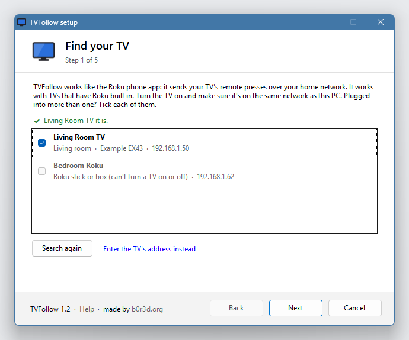

## What you need

- Windows 10 or Windows 11.
- A TV with Roku built in, the kind where the Roku menu *is* the TV's menu. Plenty of
  brands make them (TCL, Hisense, onn, Sharp and more). A Roku stick or
  box plugged into an ordinary TV won't work: it can't turn that TV on or off.
- The TV and the PC on the same home network. The TV can use Wi-Fi or a cable.

## Install

1. Download **TVFollow.exe** from the [latest release](https://github.com/still-b0r3d/TVFollow/releases/latest).
2. Open it.
   - Your browser may say the file isn't commonly downloaded. Choose **Keep**.
   - Windows may say **"Windows protected your PC"**. Click **More info**, then
     **Run anyway**. This happens because TVFollow isn't code-signed (signing costs
     money every year). If you'd rather not trust a download, [build it yourself](#build-it-yourself).
3. The setup window walks you through the rest, below. It takes about a minute.

TVFollow installs just for your Windows account and never asks for admin rights.

### Or run it portable

Rather not install anything? On setup's last page, choose **Portable: run from this
folder and change nothing else on this PC**. Put TVFollow.exe in a folder of your own
first (not straight out of a zip). TVFollow then keeps its settings and log in a
`TVFollow data` folder next to the exe, and touches nothing else: no Start menu, no
Apps list, no registry. It won't start by itself when you sign in, so open it when you
want it. To remove it, right-click the tray icon → **Quit TVFollow** and delete the
folder. To update it, replace TVFollow.exe in that folder.

## Setup, step by step

**1. Find your TV.** TVFollow looks for TVs on your network and ticks yours if there's
only one. Is the PC plugged into more than one TV? Tick each of them; steps 2 to 4 then
go through them one at a time. If a TV isn't listed, click **Enter the TV's address
instead**. The TV shows its address under **Settings → Network → About**.

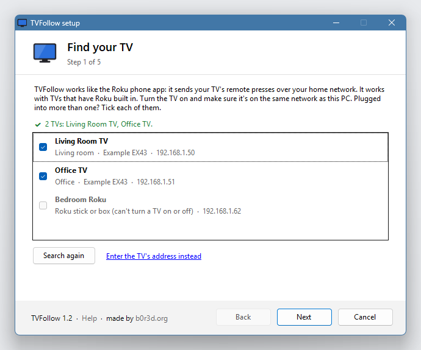

**2. Let this PC control the TV.** Newer Roku TVs come set to *Limited*, which lets
phones and PCs open apps but blocks the power button. If yours is on Limited, the
window shows what to press:

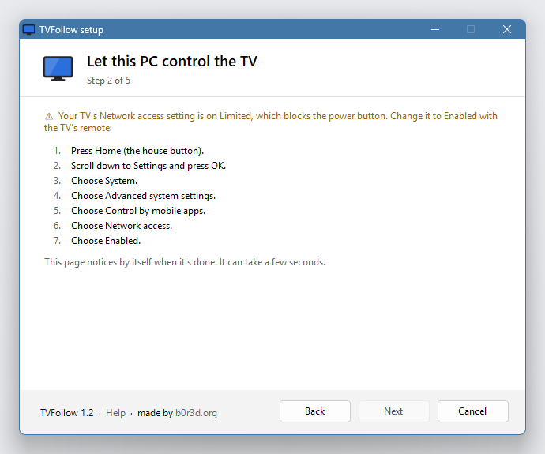

On the TV, with its remote: **Home → Settings → System → Advanced system settings →
Control by mobile apps → Network access → Enabled**. The window ticks itself off once the
TV says Enabled. "Enabled" only lets devices on your home network control the TV, not
the internet.

**3. Pick the input.** Choose the HDMI input your PC is plugged into. TVFollow picks the
one the TV is showing right now, and uses the names you've given your inputs on the TV.
**Show it on the TV** switches the TV to that input so you can check.

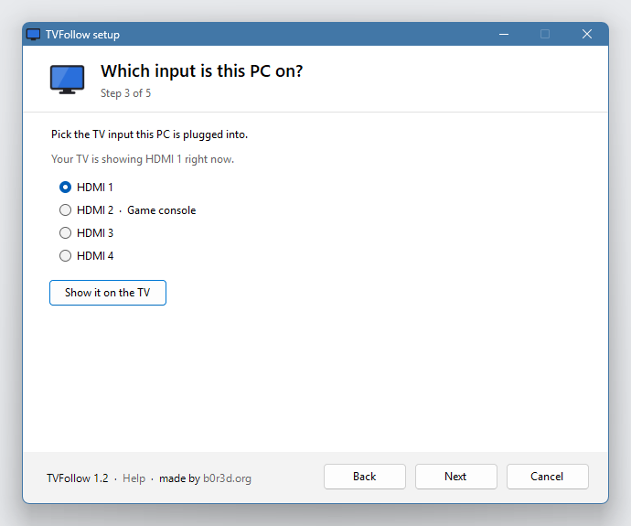

**4. Test it.** TVFollow turns the TV off, checks it can still reach it, and turns it
back on showing your PC. It takes about 15 seconds.

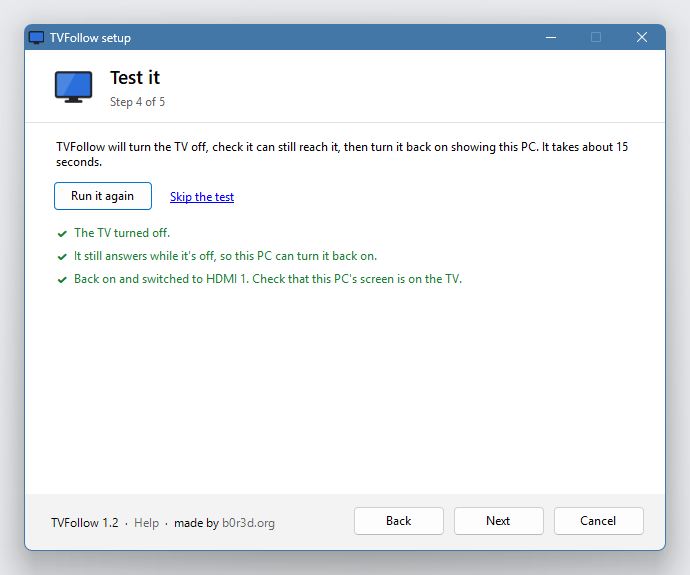

If the TV can't be reached while it's off, turn on **Fast TV start** on the TV
(**Settings → System → Power → Fast TV start**) and test again. Without it, some TVs
switch their network off along with the screen.

**5. All set.** Choose what TVFollow should do (including whether it tells you about new
versions) and whether to install it or run it portable, then click **Finish**.

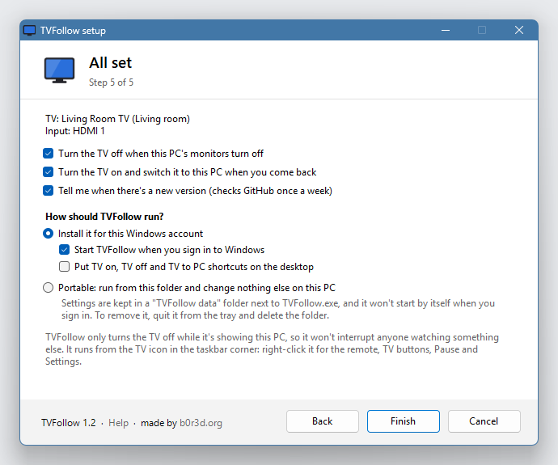

## Using it

TVFollow runs from a small TV icon in the taskbar corner. You might need to click the
**^** arrow to see it. Right-click it:

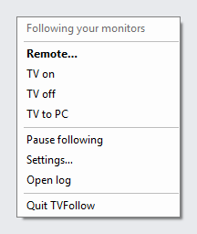

- **Remote…**: a TV remote on your screen (below).
- **TV on / TV off / TV to PC**: buttons for the TV, any time.
- **Pause following**: leave the TV alone until you resume (even across restarts), for
  example while someone watches TV and your PC goes to sleep. The icon turns grey while
  paused.
- **Settings…**: the Settings window (below). Double-clicking the icon does the same.
- **Open log**: what TVFollow did and when, handy if something seems off.
- **Quit TVFollow**: stops it. It starts again when you sign in (if it starts with
  Windows) or when you open TVFollow from the Start menu.

With two or more TVs the buttons read **All TVs on**, **All TVs off** and **All TVs to
PC**, and each TV gets a menu of its own (named as the TV calls itself) with its own TV
on, TV off, TV to PC and remote.

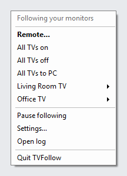

### The remote

**Remote…** opens a remote above the taskbar corner, with every button that makes
sense from a PC: power, **TV to PC**, Back, Home, the arrows and OK, Options (✱),
instant replay, Search, rewind, play/pause and fast-forward, volume and mute, and your
TV's inputs by the names you gave them.

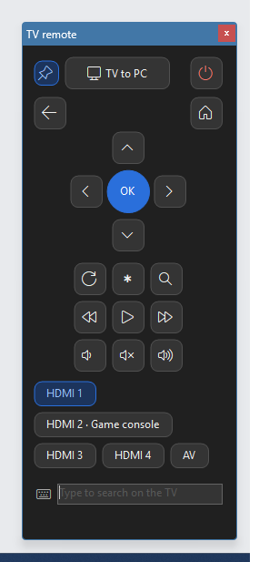

- While the remote has focus, the keyboard works too: the **arrow keys**, **Enter**
  (OK), **Backspace** (Back), **Space** (play/pause), **Home**, and **+** / **-** for
  the volume. Hold a volume button to keep going.
- The box at the bottom types into the TV: whatever you type goes into the TV's search
  boxes, a lot faster than picking letters with the arrows.
- The pin keeps the remote above other windows; **Esc** closes it.
- Prefer a different shape? Settings has three: **Classic** (above), **Compact** and
  **Wide strip**.
- With two or more TVs, a drop-down at the top of the remote picks the TV it works.

| Compact | Wide strip |
|---|---|
| 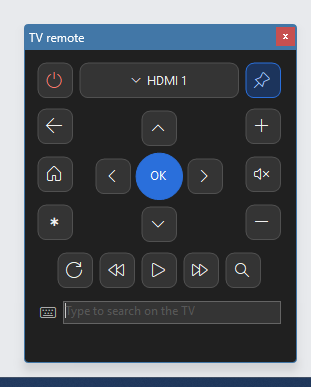 | 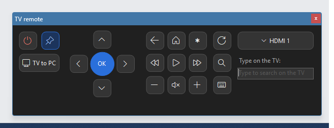 |

Voice search needs the microphone in the real remote, so it isn't here. The TV's picture
settings work the way they do with the real remote: **Options (✱)** or **Home →
Settings**, then the arrows.

### Settings

Right-click the icon → **Settings…**, double-click the icon, or open TVFollow from the
Start menu while it's running. Changes apply straight away.

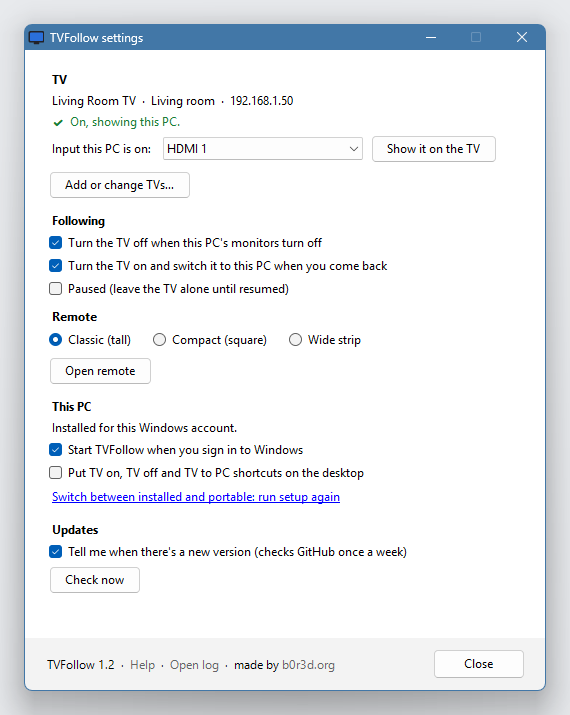

- **TV:** which TV and whether it's answering, and the input your PC is on (for each
  TV, numbered, when there are several). **Add or change TVs…** runs setup again: tick a
  new TV to add it, untick one to stop using it. TVs already set up keep their settings.
- **Following:** the two follow options, and Pause.
- **Remote:** the layout, and a button to open it.
- **This PC:** start with Windows and the desktop shortcuts. Switching between installed
  and portable runs setup again.
- **Updates:** the weekly check, and **Check now**.

If you ticked the desktop shortcuts option, **TV on**, **TV off** and **TV to PC** are on
your desktop too.

When a new version is out, a notification says so and the menu gets a **Get TVFollow …**
item that opens its download page. To update, download the new TVFollow.exe and open it:
setup remembers your TVs and keeps their settings, so it's **Next**, then **Finish**, and
finishing replaces the old version.

### How it decides

- **Monitors off** (Windows' screen timeout, sleep or shutdown): the TV turns off, but
  only if it's showing your PC.
- **Monitors back on, and you've touched the mouse or keyboard:** the TV turns on and
  switches to your PC. If someone is watching something else on it, it's left alone.
- **Monitors back on with nobody there** (a notification, a screen being plugged in):
  TVFollow waits for the mouse or keyboard before turning the TV on.
- **The router gave the TV a new address:** TVFollow finds it again by itself. After a
  router swap, press **TV to PC** in the tray once (details in [How it works](docs/HOW-IT-WORKS.md)).
- **Several TVs:** each one goes by these rules on its own, all at the same time, so one
  TV that's slow to wake doesn't hold up the others.

More detail in [How it works](docs/HOW-IT-WORKS.md).

## Change settings or uninstall

- **Change settings:** right-click the tray icon → **Settings…**, or open **TVFollow**
  from the Start menu while it's running (if it isn't running, that starts it).
- **Add, remove or change TVs, or switch between installed and portable:** **Settings… →
  Add or change TVs…** or the "run setup again" link there.
- **Uninstall:** **Settings → Apps → Installed apps → TVFollow → Uninstall** (on
  Windows 10: **Settings → Apps → Apps & features**). That removes the program, its
  shortcuts, its settings and its log. Nothing on the TV changes.

## Privacy

TVFollow talks to your TV over your home network. The only time it goes on the internet
is the update check, if you leave it on: once a week it asks GitHub what the latest
TVFollow release is. That request carries nothing about you or your TV beyond what any
web request does (your internet address, and that it's TVFollow asking). It never
downloads or installs anything by itself. Untick **Tell me when there's a new version**
in **Settings…** to switch it off. TVFollow doesn't collect anything else.

Its settings and log are in `%APPDATA%\TVFollow`. The log shows your TV's local network
address, so look it over before you share it.

## Problems?

See [Troubleshooting](docs/TROUBLESHOOTING.md). If that doesn't help,
[open an issue](https://github.com/still-b0r3d/TVFollow/issues/new/choose).

## For tinkerers

TVFollow also takes commands, for hotkeys, Stream Deck buttons or scripts:

| Command | Does |
|---|---|
| `TVFollow.exe on` | Turns the TV on |
| `TVFollow.exe off` | Turns the TV off, whatever it's showing |
| `TVFollow.exe pc` | Turns the TV on and switches it to your PC |
| `TVFollow.exe on 2` | With several TVs: `on`, `off` and `pc` do every TV, or just the one named after them, by its number in the Settings window or its name (`TVFollow.exe pc Office TV`) |
| `TVFollow.exe setup` | Opens the setup window |
| `TVFollow.exe uninstall` | Removes TVFollow (`--quiet` skips the questions) |
| `TVFollow.exe --version` | Prints the version |

After setup, TVFollow lives in `%LOCALAPPDATA%\Programs\TVFollow`.

### Build it yourself

You don't need anything installed. Windows already has the C# compiler TVFollow uses.

1. Download the source (**Code → Download ZIP**) and unzip it.
2. Double-click **build.cmd**. It makes `bin\TVFollow.exe` and waits for a key press so
   you can read how it went.
3. Open `bin\TVFollow.exe` and set it up as above.

`build.cmd test` also runs the tests, against pretend TVs. Every release is built the
same way on GitHub's own machines. The SHA-256 checksum next to each download is for
checking that download; your own build won't match it byte for byte, because the
compiler stamps each build differently.

## License

TVFollow is free. Use it, change it and share it, at home or at work, under the MIT
License with the [Commons Clause](https://commonsclause.com/): the one thing nobody may
do is sell it, or sell something whose value comes mostly from it. See
[LICENSE](LICENSE). Made by [b0r3d.org](https://b0r3d.org).

Roku is a trademark of Roku, Inc. TVFollow isn't affiliated with or endorsed by Roku.
